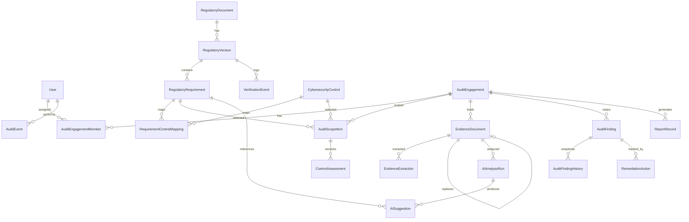

# ARCHITECTURE.md

BankShield AZ is a **single Next.js full-stack application** (one repository, one project). This replaces the earlier .NET + Angular + Docker proposal. Database access, authentication, document processing and AI orchestration all run on the server side of that one app.

Not used, by decision: a separate ASP.NET Core or Node.js backend, Angular, Docker/Docker Compose, microservices, mandatory cloud services, paid AI APIs.

## Stack

| Layer | Choice | State |
|---|---|---|
| Framework | Next.js 16.4 (App Router, Turbopack), React 19, TypeScript | installed, running |
| Styling | Tailwind CSS 4 via `@tailwindcss/postcss` | installed, running |
| Icons | lucide-react | installed, used |
| Validation | Zod 4 | installed, used for enums |
| ORM | Prisma 7 + `@prisma/adapter-better-sqlite3`, SQLite for local dev | schema validated, client generated, initial migration applied; local DB at `data/dev.db` |
| Auth | server-side Argon2id + opaque database sessions + centralized RBAC | implemented; integration tests run against isolated SQLite fixtures |
| Forms | React Hook Form | not installed (added when forms exist) |
| Charts | Recharts | not installed (Phase 6) |
| PDF reports | library to be chosen (Phase 6) | pending |
| PDF/DOCX text extraction | local libraries, to be chosen (Phase 4) | pending |
| shadcn/ui | optional, only where it helps | not installed |

Next.js 16 differs from older versions (async `params`, `proxy.ts` instead of `middleware.ts`, generated `PageProps`/`LayoutProps` types). The version's own docs ship in `node_modules/next/dist/docs/` and were used for the shell.

## Layout

```
src/
  app/
    [lang]/            locale segment (az | en)
      layout.tsx       root layout: <html lang>, metadata
      login/           bilingual public login page and Server Action
      forbidden/       localized access-denied page
      (app)/           authenticated shell and protected pages/actions
        regulatory/    database-backed sources, versions, requirements, review actions
        audits/        scoped engagement list/detail, metadata and scope actions
      actions.ts       logout Server Action
    api/health/        liveness probe, returns no data
    globals.css        design tokens (navy, teal, light surfaces)
  components/          app-shell, sidebar-nav, language-switcher, status-badge, section-placeholder
  i18n/                config, dictionaries (az.json, en.json), server helpers
  lib/
    auth/              Argon2id, database sessions, DAL, RBAC, scoped access
    audits/            validated engagement workflow, scope selection and queries
    domain/            enums, risk scoring, assessment rules (pure, unit-tested)
    regulatory/        validated source/version/requirement mutations and verification workflow
  proxy.ts             locale redirect only
prisma/schema.prisma   data model
storage-local/         private evidence directory (gitignored, never web-served)
```

## Localization

- Pages are under `/az/...` and `/en/...`. `proxy.ts` redirects paths without a locale using `Accept-Language`, defaulting to Azerbaijani. Unknown locales end in a 404.
- UI strings live in `src/i18n/dictionaries/*.json`. A test checks both files have identical keys and that Azerbaijani characters survive.
- **Legal text is never in these dictionaries.** Original wording and translations are separate columns in the database (`textOriginal`, `textTranslation`, `translationLabel`, `translationSource`).
- No CSS `text-transform: uppercase` on Azerbaijani text, to avoid dotted/dotless i problems.
- The Azerbaijani UI strings are a first draft and need a native-speaker review.

## Security model

- `proxy.ts` does locale routing only. It is not an authorization layer.
- **Authorization is enforced on the server.** The authenticated route group verifies every page, page handlers require their specific permission, and all current mutating Server Actions call `requirePermission`. Engagement mutations additionally call `requireEngagementPermission`; non-administrators must be the creator or a current `AuditEngagementMember`. Hiding UI is never the control.
- Security headers are set in `next.config.ts` (nosniff, frame deny, referrer policy, permissions policy). A Content-Security-Policy is a Phase 7 item.
- Authentication follows the Next.js 16 guidance to centralize data access and authorization in a server-side DAL; Next Server Actions provide their built-in same-origin/Origin CSRF checks. Passwords use `@node-rs/argon2` (Argon2id). Sessions are 256-bit random opaque cookies; only SHA-256 token hashes are stored in the database. The `__Host-` cookie is Secure/HttpOnly/SameSite=Strict in production; local development uses a non-Secure HttpOnly cookie on loopback. Sessions expire after eight hours and are invalidated on logout, role change, account disable, or expiry. A signing secret is not needed because the opaque token has 256 bits of randomness and is verified against the database.
- The external auth-library approach was not selected: the existing `User` model already supplies local passwords, lockout and roles, while the deployment needs a one-time CLI bootstrap and immediately revocable database sessions. Session, role and password behavior remains explicit and covered by tests; this is custom auth code and therefore merits a dedicated production security review before external exposure.
- Five failed passwords lock a known account for 15 minutes; unknown-account responses are generic and use a dummy Argon2 verification. There is no built-in per-IP/distributed rate limiter. Apply trusted reverse-proxy/firewall rate limits if reachable beyond the private on-prem network.
- Permission policy (`src/lib/auth/authorization.ts`, enforced in the DAL and each protected page/action):

  | Role | Read | Manage |
  |---|---|---|
  | Administrator | All application records | All application permissions, including users, roles, and configuration |
  | Auditor | Regulatory, audit, evidence, controls, findings, reports | Audits, control assessments, findings, reports |
  | Security Analyst | Regulatory, permitted audit, evidence, controls, findings | Evidence and control assessments |
  | Read-Only Reviewer | Regulatory, permitted audit, evidence, controls, findings, reports | None |

  Every role requires `application:access`. Only administrators receive `application:manage`, `regulatory:manage`, and `users:manage`. Non-administrators must be the engagement creator or an assigned `AuditEngagementMember` for engagement-bound data.
- Regulatory source/version/requirement changes are Server Actions guarded by `regulatory:manage` and validated server-side. New versions and requirements start pending. Verification transitions require a note and append a `VerificationEvent`; a requirement cannot be verified before its parent version. Version and requirement text is locked once review begins, and verified text is superseded through a new version rather than overwritten. There is no delete action; schema restrictions protect referenced history.
- Engagement creation/editing, requirement selection, auditor assignment, and status changes use server-side validation and the engagement-scoped authorization DAL. The workflow status graph is `DRAFT → IN_PROGRESS → IN_REVIEW → APPROVED → ARCHIVED`, with `IN_REVIEW → IN_PROGRESS` and early archive transitions. Status, metadata, auditor assignments, and scope selections append `AuditEvent` records. Auditor changes are Administrator-only; `createdById` is immutable.
- Selecting a regulatory requirement creates an `AuditRequirementSelection` that snapshots the requirement verification state, actor, time, acknowledgement, and decision note. Selection of any non-`VERIFIED` requirement requires an explicit acknowledgement and note. Existing `RequirementControlMapping` rows are converted into `AuditScopeItem` rows where available. Selection does not imply legal authority or applicability.
- Audit list/detail queries filter to Administrators or the engagement creator/current assigned auditor. Unknown or out-of-scope detail IDs resolve to not found. Search, status filtering, loading skeletons, empty states, and safe database-error responses are provided. Assessment progress, finding, and evidence figures are summaries only; assessment entry, evidence workflows, and AI analysis are not implemented.
- Audit events never contain passwords, tokens or document contents.
- Evidence: validate real file type, extension and size; generate internal storage keys; store outside `public/` under `EVIDENCE_STORAGE_DIR`; SHA-256 on write; files served only through an authorized handler; never executed or rendered as HTML; behind a small storage interface so it can be replaced.
- No evidence is sent to any external service.

## Data model

Defined in `prisma/schema.prisma`. Authentication adds `Session` (token hash, user, expiry) and `BootstrapState` (durable one-time bootstrap marker); the engagement workflow adds `auditedOrganization` and `AuditRequirementSelection`. Existing engagement, assessment, finding, and evidence records are preserved by the additive migration.

- Enum-like fields are plain `String` columns; allowed values live in `src/lib/domain/enums.ts` and are enforced with Zod. This keeps the move to PostgreSQL or SQL Server simple.
- History is kept by inserting rows: `ControlAssessment` versions (`isCurrent`), `AuditFindingHistory` snapshots, `VerificationEvent` log (including regulatory status transitions and review notes), evidence replacement chain (`replacesId`), requirement-selection decisions, and `AuditEvent` activity.
- History-bearing relations use `onDelete: Restrict` so approved records cannot disappear through cascades.
- Regulatory chain: `RegulatoryDocument` → `RegulatoryVersion` (decision number, dates, verification status) → `RegulatoryRequirement` (clause id, original text, separate translation, applicability, type, verification status, `isDemo`). `RequirementControlMapping` is many-to-many.
- Audit chain: `AuditEngagement` (+ `AuditEngagementMember` for assigned auditors and access checks) → `AuditScopeItem` → `ControlAssessment`.
- User authorization: `User.role` is checked against the four values in `src/lib/auth/authorization.ts`. Administrator has all permissions. Auditor manages audit, control assessment, finding and report records; analyst manages evidence and control assessments; read-only reviewer receives read permissions only. All non-administrator engagement record access is restricted to its creator or assigned members.
- Evidence chain: `EvidenceDocument` → `EvidenceExtraction` (per page where known) → `AIAnalysisRun` → `AISuggestion` (quotation, page, `quotationVerified`, confidence, limitations, review status).
- `AuditFinding` → `RemediationAction`; `AuditEvent` (append-only log); `ReportRecord` (content hash, approval).



### Schema review backlog (identified in Phase 1)

- Several `...ById` columns (`verifiedById`, `assessedById`, `approvedById`, `reviewedById`, `uploadedById`, `startedById`, `generatedById`, `changedById`, `VerificationEvent.actorId`) are plain strings without foreign keys to `User`. Decide whether to add relations or keep them as soft references.
- `User.role` is a single string, so one role per user. Fine for the MVP; revisit if multi-role is needed.
- `AISuggestion.requirementId` is required, which fits mappings and gaps. Confirm it also fits `INSUFFICIENT_EVIDENCE` results that are not tied to one requirement.

### Moving to PostgreSQL or SQL Server

1. Change the datasource provider and the driver adapter, and update `DATABASE_URL`.
2. SQL Server: Prisma maps `String` to `NVARCHAR(1000)` by default. Long text fields (`textOriginal`, `textTranslation`, `EvidenceExtraction.text`, `quotation`, `explanation`, `limitations`, `snapshot`, descriptions) need `@db.NVarChar(Max)`. Verify against the Prisma docs for the chosen version.
3. Re-create migrations for the new provider rather than reusing SQLite migrations.
4. Re-run the test suite and the access-control tests against the new database.

## AI-assisted review (Phase 5 design)

- Server-side interface `ComplianceDocumentAnalyzer.analyze({ documentText, requirements })`. First implementation is a **mock analyzer**, clearly labeled simulated (`AIAnalysisRun.isSimulated`). Later an optional local model through a configurable local endpoint.
- Output is validated with a Zod schema. Every quotation is checked as an exact substring of the stored extraction for the cited evidence document (and page when given); failures are rejected and logged, never saved as valid.
- Suggestions are created `PENDING_REVIEW`. No code path lets an analyzer approve an assessment, close a finding, or change a compliance status.
- Document text is untrusted data. The analyzer receives only the text and the requirements it is given, with no database or tool access.
- Insufficient evidence returns `INSUFFICIENT_EVIDENCE`. "Not found in this document" is never recorded as non-compliance.
- AI confidence, finding severity and assessment status are three separate fields and are never combined.

## Scoring rules

- Only requirements with `VERIFIED` status and applicable scope count in compliance metrics. Pending, under-review and superseded content is shown separately.
- No single compliance percentage is shown without its denominator, assessment coverage and untested items. The current dashboard shows unavailable figures as "—", not zero.
- Risk: `score = likelihood × impact`, integers on a configurable scale (default 1 to 5), configurable severity bands (default Low ≤ 4, Medium ≤ 9, High ≤ 16, Critical above). Inherent and residual risk use separate inputs. Implemented and tested in `src/lib/domain/risk.ts`. AI confidence is never an input.
- Assessment rules (`src/lib/domain/assessment.ts`): `NOT_APPLICABLE` needs a reason; approval needs reviewer justification and linked evidence (unless not applicable); an untested control cannot be approved.

## Database setup status

`prisma.config.ts` imports `dotenv/config` and reads `DATABASE_URL` through Prisma 7's config API. The local URL is `file:./data/dev.db`, resolved from the project root. The schema validates, the generated client is written to `src/generated/prisma`, and additive migrations are tracked under `prisma/migrations`. The `data/` database file and generated client are local/generated artifacts and are ignored by Git.

The generated client is used through `src/lib/db.ts` and `@prisma/adapter-better-sqlite3` 7.10.0. Authentication adds `Session` and `BootstrapState` in the migration `20261015014139_authentication`; it preserves the existing `User` columns and compliance schema. No default account is seeded. A one-time local CLI bootstrap creates the initial administrator, and no `SESSION_SECRET` is used or required.

Authentication, regulatory, and engagement tests migrate unique temporary SQLite databases and delete only their own test directories. They do not use or reset `data/dev.db`.
